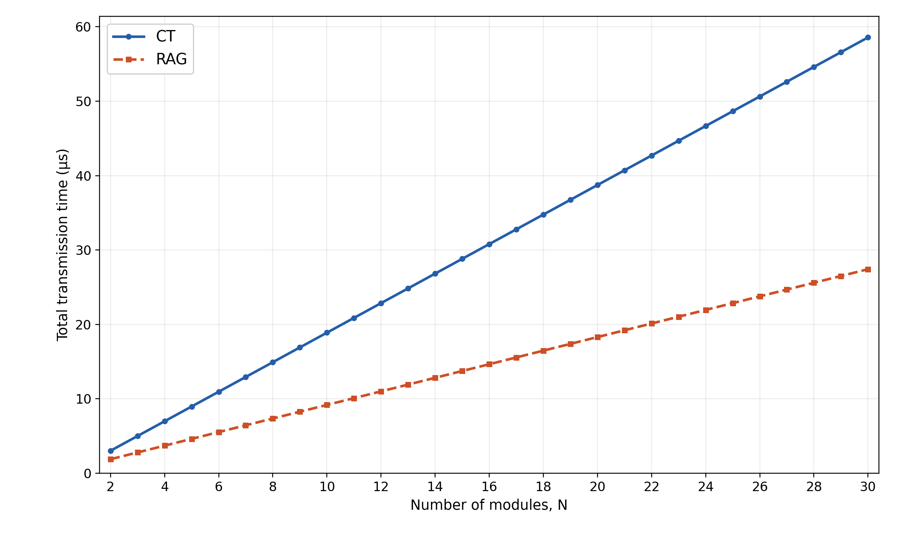
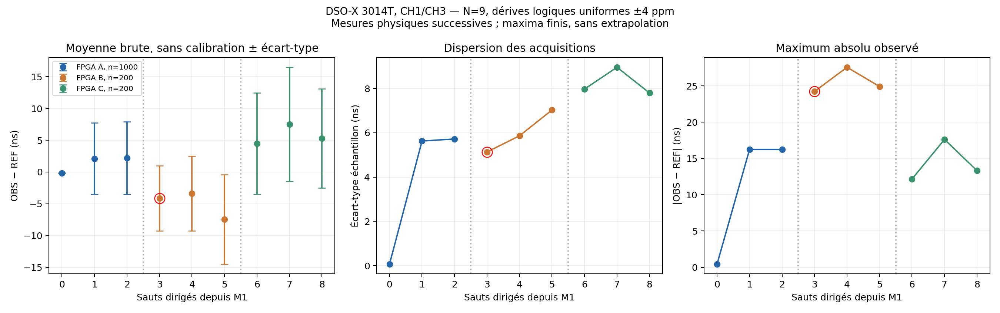

# Temps de transmission et dégradation de synchronisation

Rapport de synthèse — Obsidian_RAG — 30 octobre 2026.

> **Lecture des résultats.** Les équations CT/RAG prédisent des durées nominales à partir d'un banc de trois cartes ; les courbes jusqu'à 30 modules ne sont pas des mesures sur 30 cartes. La synchronisation a été mesurée sur neuf modules logiques répartis sur trois FPGA. Le dernier essai comprend 4 200 captures valides avec des dérives logiques individuelles uniformes entre −4 et +4 ppm. Ces mesures sont brutes, sans calibration des sondes. Un contrôle précédant M4 a relevé un déverrouillage agrégé sur B : la campagne de mesures est complète, mais ses contrôles d'état ne sont pas tous nominaux.

## 1. Périmètre et conventions

Deux questions sont traitées : combien de temps faut-il pour transporter les données, et quelle dispersion des marqueurs temporels observe-t-on à mesure que l'on s'éloigne de M1 ? Les réponses utilisent des protocoles et des plans d'observation distincts.

| Domaine | Quantité observée ou calculée | Preuve disponible |
|---|---|---|
| Transmission CT/RAG | Premier mot TX accepté → dernier mot RX accepté | Mesures de référence sur trois cartes et projections analytiques homogènes |
| Synchronisation PTP | Différence des fronts montants MOSI/TEST_OBS et SYNC de A (OBS−REF) | Mesures successives des neuf modules, dérives et configuration identifiées |
| Simulation des horloges | Temps logique de chaque moteur comparé à M1 au même instant du simulateur | Tests RTL ; liens physiques modélisés |

Le profil PTP dédié ne contient aucun chemin DATA CT/RAG. Les campagnes présentées ne valident donc pas la synchronisation sous un trafic CT/RAG simultané.

Dans les modèles de transmission, N désigne le nombre de modules d'un anneau homogène hypothétique. Pour la campagne PTP, N=9 et K=3 modules par FPGA. Ces deux usages de N ne constituent pas une validation matérielle commune.

Les durées de transmission sont exprimées en microsecondes. Les erreurs de synchronisation sont exprimées en nanosecondes. Un écart de fréquence de 1 ppm produit 1 ns de dérive libre en 1 ms.

## 2. Équations du temps de transmission

### 2.1 Sérialisation et paramètres du banc

Une trame de payload P octets comporte 32 octets d'en-tête utilisateur et 4 octets de CRC. Elle est transportée en mots de 16 bits. Le nombre de mots et la durée entre les acceptations du premier et du dernier mot sont :

$$
W(P)=\left\lceil\frac{P+36}{2}\right\rceil,
\qquad
S(P)=\tau\,[W(P)-1].
$$

Le terme W−1 est nécessaire : W événements d'acceptation définissent W−1 intervalles. Le débit considéré est celui de l'interface utilisateur ; aucun facteur 8B/10B supplémentaire n'est appliqué.

| Paramètre | Valeur nominale | Interprétation |
|---|---:|---|
| τ | 0,016 µs | Intervalle de mot accepté sans pause, soit 16 ns |
| r | 0,288 µs | Minimum observé premier RX → premier TX d'un relais local |
| β | 2,448 µs | Boucle CT du premier mot, mesurée dans le compteur de A |
| d | 0,624 µs | Délai de lien équivalent inféré sous hypothèse d'égalité |
| g | 0,048 µs | Minimum dernier TX → premier TX de la trame suivante sur un même émetteur |
| δ | Non mesuré | Réception complète → réémission de la table CT au module 1 |

La boucle comporte trois liens et deux relais :

$$
\beta=3d+2r,
\qquad
d=\frac{2{,}448-2\times0{,}288}{3}=0{,}624\ \mu s.
$$

Le paramètre d regroupe les effets effectifs du trajet Aurora/PHY/fibre et des plans d'horodatage. Il ne mesure pas la propagation optique seule et ne fournit pas trois calibrations indépendantes. Les soustractions servant à β sont réalisées dans le même compteur de A ; les résidences de relais sont calculées localement sur chaque carte.

Les valeurs proviennent de la campagne matérielle corrigée de 192 essais et 576 résumés valides. Les pauses supplémentaires, les liens hétérogènes et un trafic externe restent hors de la projection nominale.

### 2.2 Collecte puis rediffusion d'une table complète

Chaque module fournit D octets. CT réserve dès le départ une table de ND octets ; sa longueur reste constante pendant la collecte en cut-through. La trame revient au module 1 après N liens et N−1 relais. Une fois reçue entièrement, elle est réémise vers le module N à travers N−1 liens et N−2 relais.

$$
T_{CT,col}=S(ND)+Nd+(N-1)r,
$$

$$
T_{CT,red}=S(ND)+(N-1)d+(N-2)r,
$$

$$
\boxed{T_{CT,total}=2S(ND)+(2N-1)d+(2N-3)r+\delta.}
$$

Chaque phase compte une sérialisation complète. Le cut-through permet son recouvrement entre les relais d'une même phase ; il ne permet pas de supprimer la sérialisation de la seconde émission.

RAG injecte simultanément N paquets de D octets. Dans le modèle homogène et synchronisé, la cadence des tours de transmission est :

$$
C(D)=\max\{d+r,\ S(D)+g\}.
$$

Le premier terme décrit la progression d'une tête de trame ; le second décrit le service de l'émetteur, occupé jusqu'au dernier mot puis séparé de la trame suivante par g. Le retour complet d'un paquet à son origine après N sauts vaut :

$$
\boxed{T_{RAG,retour}=S(D)+d+(N-1)C(D).}
$$

Dans l'anneau idéal, tous les paquets ont la même durée. Pour des départs ou des liens différents, la fin globale serait le maximum des dates de retour dans une référence temporelle commune. La formule n'est pas une simulation générale des FIFO et de l'arbitrage.

Pour D=10 octets :

$$
S(10N)=0{,}080N+0{,}272,
\quad S(10)=0{,}352,
\quad C(10)=\max(0{,}912,0{,}400)=0{,}912.
$$

On obtient donc :

$$
\boxed{T_{CT,total}(N)=1{,}984N-0{,}944+\delta\quad[\mu s],}
$$

$$
\boxed{T_{RAG,retour}(N)=0{,}912N+0{,}064\quad[\mu s].}
$$

À N=30, les valeurs nominales sont **58,576 µs en CT** et **27,424 µs en RAG**, en posant δ=0. Cette hypothèse de réémission immédiate est explicite : ni δ ni la nouvelle phase CT de rediffusion n'ont été mesurés dans la campagne source.



### 2.3 Collecte seule des données des autres modules

L'objectif précédent diffère de la réception, au module 1, des seules données des N−1 autres modules. Ici, CT transporte (N−1)P octets et aucune rediffusion n'est attendue. En RAG, la source la plus éloignée est à N−1 sauts ; le retour du paquet propre à M1 n'est pas attendu.

$$
\boxed{T_{CT,collecte}=S((N-1)P)+Nd+(N-1)r,}
$$

$$
\boxed{T_{RAG,collecte}=S(P)+d+(N-2)\max\{d+r,S(P)+g\}.}
$$

Pour N=30 et P entre 1 et 20 octets, S(P)+g reste inférieur à 0,912 µs. Les formules deviennent :

$$
T_{CT,collecte}=S(29P)+27{,}072,
\qquad
T_{RAG,collecte}=S(P)+26{,}160.
$$

| P par module (octets) | Payload CT (octets) | CT collecte (µs) | RAG collecte (µs) |
|---:|---:|---:|---:|
| 1 | 29 | 27,584 | 26,448 |
| 5 | 145 | 28,512 | 26,480 |
| 10 | 290 | 29,664 | 26,512 |
| 15 | 435 | 30,832 | 26,560 |
| 20 | 580 | 31,984 | 26,592 |

Les résultats 29,664/26,512 µs et 58,576/27,424 µs ne représentent pas le même service : volumes CT, nombre de traversées et points d'arrêt diffèrent. Les comparer sans ces conventions conduirait à une conclusion erronée.


### 2.4 Portée des équations de transmission

Ces équations supposent des liens identiques, des injections synchrones, des buffers suffisants, le remplissage CT en vol sans coût supplémentaire et l'absence de pauses non modélisées. Elles excluent l'acquisition des données avant TX, la synchronisation initiale et les lectures JTAG ou hôte.

Le contrôle de cohérence disponible pour P=257 octets et trois sauts RAG prédit 7,728 µs, contre 7,728 à 7,840 µs dans les captures existantes. Il vérifie un cas du modèle de service ; il ne valide pas l'extrapolation matérielle à N=30 et ne constitue pas une borne de pire cas.

## 3. Équations de synchronisation

### 3.1 Horloges logiques et dérives

Chaque moteur dispose d'un accumulateur Q48.32 indépendant. Pour une dérive demandée D_i en ppb, l'incrément par tick physique est :

$$
s_i=2^{32}+\operatorname{trunc}\left(\frac{D_i2^{32}}{10^9}\right),
\qquad
A_i[n+1]=A_i[n]+s_i.
$$

La correction d'offset s'ajoute au temps issu de cet accumulateur. Les horodatages transportés et les corrections sont en Q48.16. Avec un tick nominal q=16 ns, le LSB numérique Q48.16 vaut q/2^16 = 0,000244140625 ns. Cette finesse numérique ne change pas la grille physique de capture et de génération des fronts GPIO, cadencée à 16 ns.

La fréquence logique relative réelle vaut s_i/2^32. La troncature introduit moins de 0,233 ppb d'écart à la dérive demandée. La fréquence de l'oscillateur physique de la carte s'y combine : si sa fréquence normalisée est 1+ε_b, celle du moteur est (1+ε_b)s_i/2^32. Au premier ordre, leurs erreurs relatives s'ajoutent.

Les trois moteurs d'un même FPGA ont donc des fréquences logiques distinctes, mais partagent toujours le même oscillateur physique et une partie de ses fluctuations. Neuf accumulateurs ne sont pas neuf oscillateurs physiques indépendants.

### 3.2 Estimation locale et servo d'offset

Pour un échange parent/enfant, t1 est le TX de SYNC chez le parent, t2 son RX chez l'enfant, t3 le TX de DELAY_REQ chez l'enfant et t4 son RX chez le parent. Le RTL calcule :

$$
\widehat\theta=\frac{(t_2-t_1)-(t_4-t_3)}{2},
\qquad
\widehat d=\frac{(t_2-t_1)+(t_4-t_3)}{2}.
$$

La division est un décalage arithmétique signé dans le format numérique du synchroniseur. Si e est l'erreur enfant−parent et a=(d_f−d_r)/2 l'asymétrie aller/retour, une approximation à fréquences proches et mapping fixe pendant l'échange donne :

$$
\widehat\theta\simeq e+a+\eta.
$$

η regroupe les erreurs effectives de capture et d'estimation. Le servo applique ensuite :

$$
c_i\leftarrow c_i-\widehat\theta,
\qquad e_i^{après}\simeq-a-\eta.
$$

Il corrige l'offset, avec gain unitaire ; il ne règle pas la fréquence de l'accumulateur. L'application attend notamment la fin des transactions parent/enfant et la disponibilité des codecs. Pendant cette attente et entre les mises à jour, une différence de fréquence continue à produire de la dérive. Les corrections antérieures du parent interviennent aussi dans la dynamique de l'enfant.

Pour une paire et un intervalle libre Δt, la contribution de fréquence s'écrit approximativement :

$$
e_i(t+\Delta t)-e_i(t)
\simeq(\varepsilon_i-\varepsilon_{i-1})\Delta t.
$$

En unités pratiques :

$$
\Delta e\ [ns]\simeq\Delta\varepsilon\ [ppm]\times\Delta t\ [ms].
$$

Deux injections comprises entre −4 et +4 ppm peuvent différer de 8 ppm : elles produisent jusqu'à 8 ns de dérive libre injectée en 1 ms. Ce chiffre ne borne pas l'erreur PTP totale et suppose seulement l'intervalle libre indiqué ; les oscillateurs physiques, l'asymétrie, les corrections différées et les déplacements du mapping parent restent exclus de ce calcul élémentaire.

### 3.3 Du temps logique au front physique

La mesure signée est :

$$
\Delta_i=t_{front,OBS_i}-t_{front,REF_{M1}}.
$$

À fréquences proches de l'unité, une horloge logique en avance franchit une même époque plus tôt ; son front physique est donc en avance. Au premier ordre, le signe de Δ_i est opposé à celui de l'erreur logique enfant−M1. Un Δ_i négatif indique un front OBS en avance, et non une horloge logique en retard.

Les registres GPIO, leur routage, les pistes, les sondes et les voies de l'instrument ajoutent leurs propres décalages. La dispersion commune peut se compenser lorsque REF et OBS reproduisent le même marqueur M1. La faible dispersion de M1 n'est donc pas une mesure de l'erreur PTP absolue ni une calibration commune de tous les chemins.

### 3.4 Dégradation le long de la chaîne et covariances

Le chemin de référence est dirigé : M1 → M2 → … → M9. Pour le module Mi :

$$
h=i-1,\qquad p=\lfloor h/3\rfloor,\qquad v=h-p.
$$

h compte les sauts logiques, p les frontières physiques entre FPGA et v les sauts internes. Le retour C→A sert notamment à ARM ; M9 reste synchronisé sur M8. La distance minimale non dirigée sur l'anneau n'est pas la distance pertinente.

Une écriture additive de premier ordre est :

$$
\Delta_h=b_h+\sum_{k=1}^{h}a_k
+\sum_{k=1}^{h}\xi_k+R_h+M_h+J_h.
$$

b_h regroupe les biais d'observation ; a_k les asymétries effectives ; ξ_k les fluctuations locales ; R_h la dynamique résiduelle de fréquence, de correction différée et de cascade ; M_h l'effet des marqueurs et de la mesure ; J_h les excursions non décrites par le régime central.

Pour la composante centrale, la variance conserve les covariances :

$$
\begin{aligned}
\operatorname{Var}(\Delta_h)=\;&\sum_k\operatorname{Var}(\xi_k)
+2\sum_{j<k}\operatorname{Cov}(\xi_j,\xi_k)\\
&+\operatorname{Var}(R_h+M_h)
+2\sum_k\operatorname{Cov}(\xi_k,R_h+M_h).
\end{aligned}
$$

Une loi telle que σ²=σ0²+vσv²+pσp² exige donc des hypothèses supplémentaires d'indépendance et d'homogénéité. Les moyennes peuvent avoir des signes différents aux frontières ; elles ne doivent pas être supposées croissantes avec h.

Même des fréquences injectées indépendamment ne produisent pas des écarts adjacents indépendants. En posant δ_k=ε_k−ε_(k−1), on a, pour des ε indépendants de variance σ_ε² :

$$
\operatorname{Var}(\delta_k)=2\sigma_\varepsilon^2,
\qquad
\operatorname{Cov}(\delta_k,\delta_{k+1})=-\sigma_\varepsilon^2.
$$

Si les âges de correction étaient tous égaux à T, la somme des contributions de fréquence télescoperait :

$$
T\sum_{k=1}^{h}(\varepsilon_k-\varepsilon_{k-1})
=T(\varepsilon_h-\varepsilon_0).
$$

Cette identité explique pourquoi une addition automatique de variances de dérive par saut serait incorrecte. Dans le RTL réel, les âges et les mappings ne sont pas identiques ; les captures successives ne permettent pas d'identifier ces covariances.

## 4. Mesures du 30 octobre : neuf dérives logiques ±4 ppm

### 4.1 Configuration et acquisition

La campagne de référence courante est **run_id=11**, **config_id=16c87b5a422b4f71**. Les cartes sont A=OBS001A, B=OBS003A et C=OBS002A. Elles portent chacune trois moteurs de la même image K=3.

Les neuf valeurs sont tirées une fois, indépendamment, par une loi uniforme discrète en ppb entre −4000 et +4000, avec graine 20261030. Elles restent fixes pendant les captures. Elles ne constituent pas une répartition régulièrement espacée ni un nouveau tirage de phase à chaque acquisition.

Les autres paramètres sont : période logique 100 µs, maintenance nominale 1 ms, offsets initiaux nuls, aucun jitter ni perte injectés et un tick d'injection par direction. Les délais physiques Aurora s'ajoutent aux délais injectés.

Le Keysight DSO-X 3014T mesure CH1 sur SYNC de A et CH3 successivement sur MOSI/TEST_OBS de A, B et C, sondes ×10. La sélection du module est relue par JTAG. L'acquisition normale, sans moyennage, conserve les octets des deux voies, leurs préambules et leurs axes temporels. Les fronts sont appariés au seuil de 1,65 V.

L'acquisition segmentée enregistre 200 fronts successifs en environ 0,3 seconde de commande instrument ; leurs étiquettes temporelles couvrent environ 20 ms de signal à 100 µs de période. Le transfert des formes d'onde vers le PC prend plusieurs dizaines de secondes par lot. Les dates UTC des fichiers sont des dates d'export, pas les dates des fronts.

A fournit cinq rafales de 200 enregistrements par module ; B et C une rafale de 200 par module pour raccourcir l'attente. Les tailles d'échantillon et les expositions temporelles diffèrent. Les 4 200 paires ont passé l'analyse des formes d'onde, sans acquisition rejetée dans les neuf séries finales.

**Aucune calibration commune des sondes n'est appliquée à ce run.** Aucun biais mesuré pendant une autre campagne n'est réutilisé. Les décalages instrumentaux et les chemins GPIO/PCB restent inclus.

### 4.2 Résultats selon le nombre de sauts

σ est l'écart-type échantillon, calculé avec n−1. Le maximum est le plus grand |OBS−REF| de la série finie ; il ne constitue pas une borne garantie.

| Module | h | p | Dérive (ppm) | n | Moyenne brute (ns) | σ (ns) | Max. absolu (ns) |
|---|---:|---:|---:|---:|---:|---:|---:|
| M1 | 0 | 0 | +0,467 | 1000 | −0,186 | 0,075 | 0,457 |
| M2 | 1 | 0 | −2,200 | 1000 | +2,113 | 5,629 | 16,246 |
| M3 | 2 | 0 | +0,589 | 1000 | +2,212 | 5,721 | 16,246 |
| M4 | 3 | 1 | −1,266 | 200 | −4,148 | 5,135 | 24,229 |
| M5 | 4 | 1 | +3,090 | 200 | −3,370 | 5,865 | 27,560 |
| M6 | 5 | 1 | −0,627 | 200 | −7,442 | 7,028 | 24,913 |
| M7 | 6 | 2 | −3,694 | 200 | +4,454 | 7,973 | 12,171 |
| M8 | 7 | 2 | +2,011 | 200 | +7,519 | 8,959 | 17,618 |
| M9 | 8 | 2 | +2,498 | 200 | +5,275 | 7,799 | 13,314 |



La dispersion observée sur M2/M3, pourtant internes à A, atteint environ 5,6 à 5,7 ns. Le profil avec fréquences logiques distinctes ne se décrit donc pas par le modèle historique qui fixait la contribution virtuelle à zéro dans une autre configuration.

À huit sauts, M9 présente une moyenne brute de +5,275 ns et un écart-type de 7,799 ns. Le plus grand maximum absolu de cette campagne, 27,560 ns, apparaît sur M5 à quatre sauts. Le plus grand écart-type, 8,959 ns, apparaît sur M8 à sept sauts. Les mesures ne justifient ni une moyenne monotone avec h ni une loi universelle ajustée à partir de ces neuf points.

### 4.3 Événement d'état conservé

Avant la capture de M4, B répond avec `operational=true`, liens actifs et aucune erreur PHY, mais `all_local_locked=false`. Le statut indique qu'au moins un moteur local est déverrouillé ; il ne permet pas de dire que ce moteur est M4, ni d'en déduire la durée. Le contrôle suivant est nominal.

Les formes d'onde M4 sont conservées et valides pour la mesure du délai. Le contrôle d'état associé reste signalé en rouge dans la figure. Le statut de campagne est `complete_with_health_events` : toutes les données attendues ont été acquises, mais l'ensemble des contrôles nominaux n'est pas passant.

## 5. Place du modèle historique du 29 octobre

La campagne précédente utilisait des dérives logiques nulles et un autre réglage instrumental. Après sa propre calibration commune, son modèle central descriptif était :

$$
\mu(h)\simeq0{,}002319
-23{,}150096\,\mathbf1_{h\ge3}
+13{,}478333\,\mathbf1_{h\ge6}\quad[ns],
$$

$$
\sigma(h)\simeq\sqrt{0{,}035885^2+19{,}185273\,p(h)}\quad[ns].
$$

Le coefficient de frontière équivalent était 4,38010 ns ; la contribution virtuelle était fixée à zéro par parcimonie dans ce régime. Il s'agit d'un ajustement effectif à N=9, pas d'une propriété intrinsèque des liens ni d'une loi validée à d'autres N.

Un calcul conditionnel avec quatre erreurs effectives d'horodatage indépendantes, uniformes et de largeur q=16 ns donne σ_η=q/√12=4,619 ns. Ce calcul donne un ordre de grandeur sous ces hypothèses ; il ne démontre ni un plancher de bruit matériel ni l'indépendance des erreurs. Les horodatages numériques restent en Q48.16.

Trois excursions ciblées sur M7, de −67,979 ns, +57,156 ns et −58,656 ns bruts, restent des observations historiques distinctes. Elles ont été sélectionnées par un déclenchement hors fenêtre ; leur probabilité n'est pas identifiée. Elles ne doivent ni être mélangées aux échantillons centraux ni disparaître parce que les maxima du run11 sont plus petits.

Le run10 du 30 octobre a été interrompu par une réinitialisation ou déconnexion matérielle. Il est conservé séparément. Ses données et sa calibration ne sont pas mélangées au run11.

Le changement de dérives, les redémarrages, l'instrumentation et les fenêtres d'acquisition empêchent d'attribuer quantitativement toute différence entre les campagnes à la seule injection ±4 ppm. Aucun nouvel ajustement extrapolatif n'est ajouté au run11.

## 6. Conditions de validité et conclusion technique

Les équations de transmission sont utilisables comme prévisions nominales avec leurs conventions de début et de fin, leurs coefficients et leurs hypothèses explicites. La collecte seule doit rester distincte de la collecte suivie de rediffusion. Une borne de pire cas exigerait aussi les pauses, l'arbitrage, les files et le délai δ d'une réalisation donnée.

La synchronisation est caractérisée par les distributions marginales observées de neuf modules, avec un tirage fixe de fréquences et trois oscillateurs physiques. Les données montrent une dispersion de plusieurs nanosecondes dès les liens internes avec dérives logiques distinctes. Elles ne séparent pas les contributions de quantification, d'asymétrie, de dérive, d'application différée et d'instrumentation.

Les acquisitions successives et corrélées ne déterminent pas les covariances entre modules. Les lectures JTAG avant/après sont ponctuelles ; elles ne prouvent pas un verrouillage continu. L'appariement de fronts périodiques ne prouve pas à lui seul l'identité absolue des époques, l'absence de pulses perdus pendant les temps morts ou la couverture des événements rares.

L'interpolation des fronts entre échantillons ADC ne confère pas une exactitude absolue à la picoseconde. Les maxima et quantiles sont empiriques. Les seuils de dépassement présents dans les CSV sont descriptifs ; aucun seuil d'acceptation utilisateur n'a été imposé.

La conclusion mesurée est donc : **à N=9/K=3, avec cette réalisation de dérives ±4 ppm, le dernier module présente σ=7,799 ns et le maximum absolu observé sur l'ensemble des séries vaut 27,560 ns ; un événement de déverrouillage agrégé sur B reste à prendre en compte.** Cette conclusion porte sur les captures disponibles et ne constitue pas une garantie générale de précision temporelle.

## 7. Sources, archives et reproduction

Les sources sont regroupées dans les archives ZIP du dossier [data](data/), avec les chemins de membres d'origine. Le catalogue commun décrit leur contenu et leurs empreintes. Les archives sont conservées sans perte afin de permettre la reproduction des résultats sans maintenir des milliers de petits fichiers dans l'arborescence courante.

| Archive | Membres de référence |
|---|---|
| [scope_20261030_run11.zip](data/scope_20261030_run11.zip) | `reports/ptp_scope_4ppm_dsox3014t_run11_20261030/` : CSV, qualification JSON, formes d'onde, préambules et événement d'état |
| [scope_20261030_run10.zip](data/scope_20261030_run10.zip) | `reports/ptp_scope_4ppm_dsox3014t_20261030/` : campagne interrompue, distincte du run11 |
| [scope_20261029.zip](data/scope_20261029.zip) | `reports/ptp_scope_20261029T160956Z/` : campagne historique et excursions ciblées |
| [hardware.zip](data/hardware.zip) | Paramètres et données matérielles servant aux équations de transmission |
| [models_history.zip](data/models_history.zip) | Rapports théoriques de transmission et ajustement historique de distance PTP |
| [validation.zip](data/validation.zip) | Préparation des dérives, résultats des tests et validations RTL |

Les définitions exécutables de transmission sont dans [plot_theoretical_rtt.py](../scripts/plot_theoretical_rtt.py) et [plot_payload_sweep_n30.py](../scripts/plot_payload_sweep_n30.py). L'estimation et l'application des corrections sont dans [sync_system.vhd](../rtl/sync/sync_system.vhd), notamment les calculs d'estimation et la mise à jour différée. Le câblage des accumulateurs et liens est dans [ptp_emulation_core.vhd](../rtl/system/ptp_emulation_core.vhd), et la génération des marqueurs dans [ptp_epoch_marker.vhd](../rtl/sync/ptp_epoch_marker.vhd).

La description runtime et les plans de mesure sont dans [ptp_emulation.md](../docs/ptp_emulation.md). L'analyse des formes d'onde est dans [ptp_scope_report.py](../scripts/ptp_scope_report.py), la qualification selon les sauts dans [report_ptp_scope_distance.py](../scripts/report_ptp_scope_distance.py), et le modèle historique conditionnel dans [ptp_distance_model.py](../tools/ptp_distance_model.py).

Exemple de restauration dans un répertoire de travail, depuis la racine du dépôt :

```powershell
py -3 scripts/report_archive.py extract reports/data/scope_20261030_run11.zip --output build/report_replay
py -3 scripts/report_ptp_scope_distance.py build/report_replay/reports/ptp_scope_4ppm_dsox3014t_run11_20261030 --config config/ptp_emulation_9_uniform_4ppm_run11.json --allow-uncalibrated
```

La seconde commande est une analyse hors ligne. Elle n'ouvre ni VISA ni JTAG et ne programme aucune carte. Les empreintes des sources d'acquisition et d'analyse, l'identité de l'instrument, le chargement des cartes et le `config_id` restent dans la provenance du run11.
