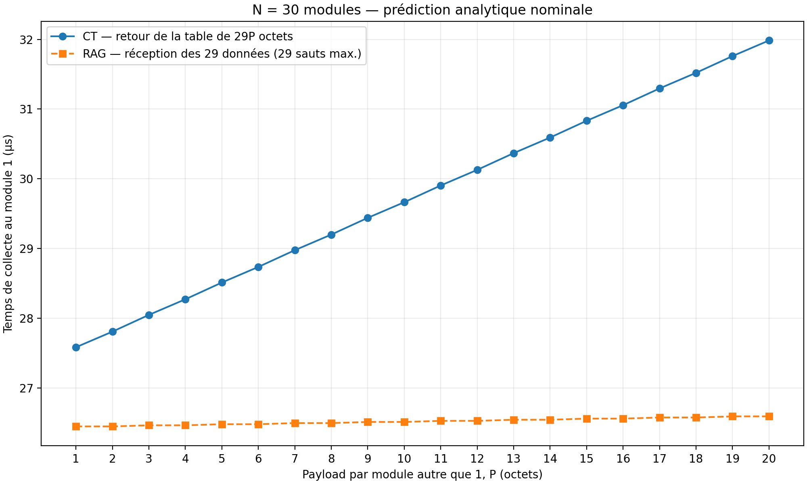

# Collecte au module 1 : N = 30, P de 1 à 20 octets



## Objectif et hypothèses

Le temps se termine lorsque le module 1 a reçu intégralement les données des
29 autres modules. P est un nombre entier d'octets, identique pour ces modules.
Le modèle reprend les coefficients du [rapport source](../theoretical_rtt_10bytes/rapport_equations_limitations.md) :
τ = 0,016 µs, d = 0,624 µs, r = 0,288 µs et g = 0,048 µs.

En CT, la trame réserve dès son départ les 29 emplacements, soit un payload
constant de 29P octets sur tout le parcours. Chaque module remplit son emplacement
en cut-through sans retard supplémentaire. Les données propres du module 1 sont
exclues. Le temps commence au premier mot TX du module 1 et comprend 30 liens
et 29 relais. Aucune rediffusion n'est nécessaire pour cet objectif.

En RAG, les 29 sources injectent simultanément chacune un paquet de P octets.
On conserve la cadence homogène et synchronisée du rapport ; une injection
simultanée de même taille par le module 1 est compatible avec ce modèle,
mais son retour n'est pas attendu. Le temps commence aux premières émissions.
Les distances des 29 sources au module 1 sont de 1 à 29 sauts. La dernière
donnée arrive donc après 29 sauts, avec 28 relais. La réception du dernier mot
du paquet inclut le CRC selon la convention de sérialisation du rapport.

## Équations utilisées

Toutes les durées sont en microsecondes :

\[
S(x)=0{,}016\left(\left\lceil\frac{x+36}{2}\right\rceil-1\right).
\]

\[
T_{CT}(P)=S(29P)+30d+29r=S(29P)+27{,}072.
\]

Pour RAG, la donnée située à h sauts arrive à S(P)+d+(h−1)C :

\[
C(P)=\max(d+r,S(P)+g),\qquad
T_{RAG}(P)=\max_{h=1,\ldots,29}[S(P)+d+(h-1)C(P)].
\]

Entre 1 et 20 octets, S(P)+g varie de 0,336 à 0,480 µs, toujours inférieur
à d+r = 0,912 µs. Par conséquent :

\[
T_{RAG}(P)=S(P)+0{,}624+28\times0{,}912=S(P)+26{,}160.
\]

## Résultats

| P (octets/module) | Payload CT (octets) | CT (µs) | RAG (µs) | CT − RAG (µs) |
|---:|---:|---:|---:|---:|
| 1 | 29 | 27,584 | 26,448 | 1,136 |
| 5 | 145 | 28,512 | 26,480 | 2,032 |
| 10 | 290 | 29,664 | 26,512 | 3,152 |
| 15 | 435 | 30,832 | 26,560 | 4,272 |
| 20 | 580 | 31,984 | 26,592 | 5,392 |

CT augmente d'environ 0,232 µs par octet de P car la trame contient 29P octets.
RAG augmente d'environ 0,008 µs par octet : les paquets circulent en parallèle
et la cadence reste dominée par d+r. L'arrondi aux mots de 16 bits produit
de petites marches ; en RAG, deux valeurs successives de P partagent souvent
le même temps. Les points de la figure sont reliés pour guider la lecture.

Le rapport précédent obtenait, pour N=30 et P=10, un total CT de 58,576 µs
avec 300 octets et rediffusion, et un retour RAG à l'origine de 27,424 µs.
Le présent objectif diffère : 290 octets CT, collecte seule, et arrivée des
données des autres modules au module 1 en RAG. Exiger le retour RAG complet
ajouterait C = 0,912 µs aux valeurs présentées ici.

## Portée et reproduction

Ceci est un balayage analytique hors ligne, pas une simulation RTL, ni une
simulation générale de FIFO et d'arbitrage. Les coefficients proviennent de
trois cartes ; ils ne valident pas un anneau matériel de 30 modules. Les liens
sont supposés identiques, les buffers suffisants, les départs simultanés,
sans pauses supplémentaires ni trafic externe. Acquisition, préparation et
lecture hôte sont exclues. Les résultats sont nominaux et ne sont pas des
bornes de pire cas. Le remplissage CT en vol reste une hypothèse du modèle.

Depuis la racine du dépôt :

```powershell
py -3 scripts/plot_payload_sweep_n30.py
```

Les [20 points CSV](collection_vs_payload.csv), les exports
[PDF](collection_vs_payload.pdf) et [SVG](collection_vs_payload.svg), ainsi que les
[paramètres et empreintes des sources](model_assumptions.json) sont conservés
dans ce dossier. Le CSV inclut aussi le retour RAG complet à titre de référence.
